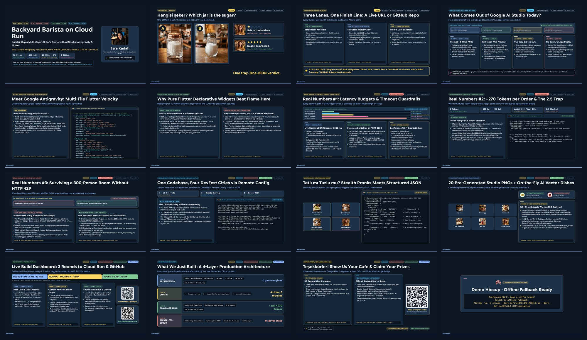
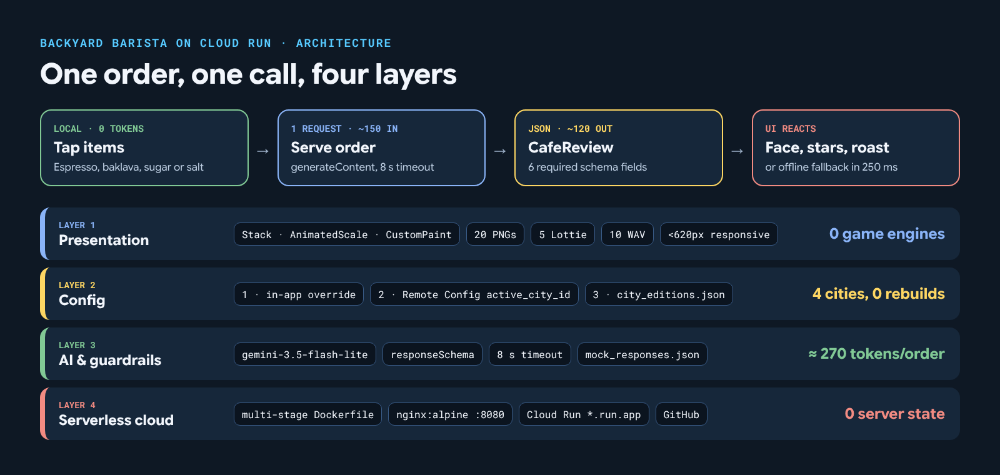

# Backyard Barista on Cloud Run: Tatlı mı Tuzlu mu? ☕🥐🧂☁️

**DevFest 2026 Hands-On Workshop & Vibe Lounge Starter Repository**
- **Author:** Esra Kadah (Tech Lead, Senior Flutter & AI Engineer at Antigua Mobile Berlin · Flutter & Dart GDE)
- **Live Cloud Run Reference App (`europe-west3` · 3D Characters + Lottie + 10 Web Audio SFX):** `https://backyard-barista-389486729482.europe-west3.run.app` (`devfest-backyard-barista-2026`)
- **Live Cloud Run Mirror (`europe-west1`):** `https://backyard-barista-870328613866.europe-west1.run.app` (`soundstage-dea29`)
- **City Editions Included:**
  - `berlin` (🇩🇪 DevFest Berlin, 14 Nov 2026)
  - `gaziantep` (🇹🇷 DevFest Gaziantep, 15 Nov 2026)
  - `adana` (🇹🇷 DevFest Adana, 11 Dec 2026)
  - `istanbul` (🇹🇷 DevFest Istanbul, 19 Dec 2026)

---

## What You Build Today

A zero-typing, tap-to-serve 2-player AI Cafe Game where players assemble **Drinks** (`Espresso`, `Milk`, `Menengiç Kahvesi`) and **Simple Foods** (`Croissant`, `San Sebastian Cheesecake`, `Baklava`) by tapping ingredients on the counter.

Right next to the **Sugar (`Şeker`)** jar sits a deceptive **Salt (`Tuz`)** shaker and **Chili Sauce (`Acı Sos`)**! If a player sneaks Salt into a sweet order, **Gemini (`gemini-3.5-flash-lite` via REST `generateContent` in `package:http` for zero-setup workshops, or `firebase_ai` + App Check in production)** catches the sabotage in its structured JSON review (`ratingStars: 1`, `tasteVerdict: "salty_sabotage"`, `customerReaction`) and roasts the barista with a city-specific joke.

---

## Choose Your Workshop Lane

### Lane A: Zero-Install Browser Path (Google AI Studio Build Mode -> Cloud Run + GitHub)
1. Open [Google AI Studio](https://aistudio.google.com) -> **Build** mode.
2. Copy and paste [`prompts/step-1-base-cafe.md`](prompts/step-1-base-cafe.md) to generate the 2-player Cafe Counter with our 12 base menu items and the 4-City Edition switcher (`Berlin`, `Gaziantep`, `Adana`, `Istanbul`).
3. Copy and paste [`prompts/step-2-custom-dish.md`](prompts/step-2-custom-dish.md) to generate your own **Custom Signature Dish SVG** and **Custom Prank Ingredient SVG** on the fly, wired to the Gemini JSON customer judge.
4. Follow [`prompts/step-3-deploy.md`](prompts/step-3-deploy.md) to click **Deploy to Cloud Run** (`.run.app`, no credit card required on AI Studio Starter Tier) and **Sync to GitHub**.

### Lane B: Flutter + Gemini REST API (`package:http`) + Google Antigravity IDE -> Cloud Run + GitHub
```bash
cd flutter_client
flutter pub get
flutter run -d chrome --dart-define=DEFAULT_CITY=gaziantep --dart-define=GEMINI_API_KEY=your_key_here
```
- **Offline Conference Wi-Fi Fallback:** Pass `--dart-define=OFFLINE_MODE=true` (or leave `GEMINI_API_KEY` empty) to use deterministic city-specific responses from `flutter_client/assets/offline_fallback/mock_responses.json`.
- **Switch City Editions:** Click the flag badge in the top bar (`🇩🇪 Berlin` / `🇹🇷 Gaziantep` / `🇹🇷 Adana` / `🇹🇷 Istanbul`) to open the Settings drawer, or update `active_city_id` in Firebase Remote Config (`flutter_client/remote_config_template.json`).

### Lane C: Phone Play-Tester
Scan any classmate's deployed `.run.app` QR code on the stage screen to test their cafe on your phone and slip Salt (`Tuz`) into a sweet order!

---

## Deck at a Glance



The talk follows a 5-act arc shown on every slide (Hook, Tools, Gerçek Rakamlar, Under the Hood, Build & Ship) and opens with an audience poll: *Hangisi şeker?* Before stage day, run the checklist in [`docs/stage-runbook.md`](docs/stage-runbook.md), including the PDF backup export.



---

## Repository Structure

```text
devfest-2026-backyard-barista-cloudrun/
├── README.md
├── ai_studio_lane_a/
│   └── index.html             # Self-contained Lane A reference web game (HTML/CSS/JS + 5s tea sip + Web Audio)
├── docs/
│   ├── benchmark-report-2026-10-24.md # 50-request Cloud Run & offline fallback latency report (53.8ms p50)
│   ├── challenge-landing-page.md      # Bilingual (TR + EN) Vibe Lounge & Workshop challenge sheet
│   ├── rehearsal-3g-report-2026-10-24.md # Section 4.6 Slow 3G (750 Kbps / 150ms RTT) & HTTP 429 chaos report
│   ├── speaker-drill-cards-tr.md      # Stage drill scripts (Drills 1-4: 60s open, 90s close, 5m cut, 20m recovery)
│   ├── stage-runbook.md               # T-24h / T-2h / T-15m checklist, 5-act timing table, failure playbook
│   ├── companion-deck/                # Source of the attendee Workshop Companion deck (16 slides, Claude Slides format)
│   ├── visuals/                       # architecture.png, social-card.png, deck-overview.jpg (+ src/ to re-render)
│   └── vibe-lounge-poster.html        # Print-ready A4 Vibe Lounge table poster with live Cloud Run QR
├── prompts/
│   ├── step-1-base-cafe.md    # AI Studio Build mode seed prompt (Base Cafe + 4-City Switcher + 5s Tea Sip)
│   ├── step-2-custom-dish.md  # On-the-fly custom SVG dish + prank icon + Gemini JSON judge
│   └── step-3-deploy.md       # One-click Cloud Run (.run.app) & GitHub sync guide
├── slides/                    # 15-slide flutter_deck presentation (5-act story arc) + Stage Navigator + Turkish speaker notes
│   ├── pubspec.yaml
│   ├── lib/
│   │   ├── main.dart
│   │   ├── theme.dart
│   │   ├── plugins/presenter_menu_plugin.dart
│   │   └── slides/            # Slides 1..15 + /demo-hiccup backup slide
│   ├── test/
│   │   ├── deck_manifest_test.dart
│   │   └── slides_render_test.dart  # Renders every slide with the real fonts and fails on any overflow
│   └── tool/
│       ├── export_slides_test.dart  # flutter test tool/export_slides_test.dart -> build/slides/*.png
│       └── pngs_to_pdf.py           # python3 tool/pngs_to_pdf.py -> offline PDF backup of the deck
└── flutter_client/            # Self-contained Flutter Web app & Cloud Run build context
    ├── pubspec.yaml
    ├── Dockerfile             # Multi-stage Cloud Run container (PORT=8080)
    ├── remote_config_template.json
    ├── tool/
    │   ├── benchmark_gaziantep.dart   # 50-request Gerçek Rakamlar CLI latency & token cost harness
    │   └── rehearsal_3g_check.dart    # Section 4.6 Slow 3G & HTTP 429 chaos verification suite (5/5 PASS)
    ├── assets/
    │   ├── animations/        # 5 ready-made Lottie JSON animations (coffee_steam_loop, barista_brewing_pulse, sweet_celebration_burst, salty_spicy_explosion, tea_sip_steam_loop)
    │   ├── audio/             # 10 cafe sound effects + Web Audio API synth (coffee_grinder, espresso_steam, serve_bell, level_up, tap_pop, stealth_wink, tea_sip, sweet_fanfare, salty_buzzer, next_chime)
    │   ├── base/              # 20 studio 9D PNG cafe & 3D character assets (12 Round-1 base + 2 Round-2 custom + 6 3D characters, 512x512)
    │   │   ├── characters/    # barista_p1.png, pastry_chef_p2.png, customer_ayse_usta.png, customer_mustafa.png, customer_lukas.png, customer_deniz.png
    │   │   ├── drinks/        # espresso.png, milk.png, menengic_coffee.png
    │   │   ├── foods/         # croissant.png, san_sebastian.png, baklava.png, katmer_roll.png
    │   │   ├── toppings_pranks/ # sugar_jar.png, salt_shaker.png, chili_sauce.png, isot_pepper.png
    │   │   └── customers/     # customer_happy.png, customer_shocked.png, customer_salty_disgusted.png
    │   ├── fonts/             # Bundled GoogleSans-Regular, Medium, SemiBold, Bold (.ttf)
    │   ├── editions/
    │   │   └── city_editions.json
    │   └── offline_fallback/
    │       └── mock_responses.json
    └── lib/
        ├── main.dart
        ├── config/
        │   └── city_edition_controller.dart
        ├── data/
        │   ├── ingredients_catalog.dart
        │   └── custom_svg_items.dart
        ├── models/
        │   ├── cafe_review.dart
        │   └── customer_order_ticket.dart
        ├── services/
        │   ├── cafe_judge_service.dart
        │   ├── cafe_sound_controller.dart
        │   ├── sound_player_io.dart
        │   ├── sound_player_stub.dart
        │   └── sound_player_web.dart
        └── ui/
            ├── cafe_character_animations.dart
            ├── cafe_counter_screen.dart
            └── city_settings_drawer.dart
```

---

## Full Production Architecture ("En Son Mimaride Ne Yaptık?")

1. **Layer 1 (Presentation & Hybrid Assets):** Pure Flutter Declarative Widgets (`Stack`, `AnimatedScale`, `AnimatedSwitcher`, `CustomPaint`) combining 20 pre-generated PNGs in `assets/base/` (`12` Round-1 base PNGs + `2` Round-2 custom PNGs + `6` 3D character portraits) with on-the-fly Antigravity/Gemini-generated `CustomVectorIngredientGraphic` vector artwork (`custom_svg_items.dart`), `5` Lottie JSON animations, and `10` synthesized WAV + Web Audio API audio cues.
2. **Layer 2 (3-Layer Multi-City Configuration in `CityEditionController`):**
   - **Priority 1:** In-App Settings Switcher Override (`_manualOverrideCityId` via `city_settings_drawer.dart`)
   - **Priority 2:** Firebase Remote Config template / `--dart-define=DEFAULT_CITY` (`_remoteConfigCityId` via `remote_config_template.json`)
   - **Priority 3:** Bundled local fallback (`_fallbackCityId` from `assets/editions/city_editions.json`)
3. **Layer 3 (AI & Guardrails):** Single-shot structured JSON output (`CafeReview`) evaluated by `gemini-3.5-flash-lite` over REST `generateContent` (`package:http` for zero-setup workshops; upgrade to `firebase_ai` + Firebase App Check in production) with an `8,000 ms` live timeout and a `250 ms` deterministic offline fallback (`mock_responses.json`).
4. **Layer 4 (Serverless Cloud & Source Control):** Stateless `nginx:alpine` container (`Dockerfile`, lines 1-20) deployed via `gcloud run deploy backyard-barista --source .` to **Google Cloud Run (`*.run.app`)** and synced to **GitHub**.
