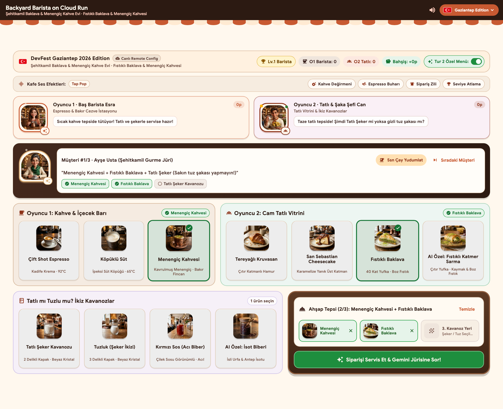

# Building a Zero-Engine Multiplayer AI Cafe Game with Flutter, Gemini 3.5 Flash-Lite, and Cloud Run (Real Latency & Cost Numbers)

When you run a 40-minute live-coding workshop for 300 developers on conference Wi-Fi, two things will break your session faster than a syntax error:

1. Asking an LLM to generate a 2D game engine loop (`Component`, `Hitbox`, `SpriteBatch`, collision callbacks) under time pressure.
2. Handing 300 attendees instructions to create their own Gemini API keys on stage.

For my **DevFest Gaziantep 2026** & **Cloud Run Challenge** session (*"Building Multiplayer AI Games with Flutter, Antigravity & Cloud Run"*), I built **Backyard Barista**: a 2-player cooperative (and stealth-sabotage) cafe game that runs in the browser at 60-120 FPS and deploys as a single multi-stage container to Google Cloud Run.

Play the live production build here:
- **Primary Cloud Run (`europe-west3`):** [https://backyard-barista-389486729482.europe-west3.run.app](https://backyard-barista-389486729482.europe-west3.run.app)
- **Mirror Cloud Run (`europe-west1`):** [https://backyard-barista-870328613866.europe-west1.run.app](https://backyard-barista-870328613866.europe-west1.run.app)
- **Source Code & 16-Slide Deck (`MIT`):** [https://github.com/esrakadah/devfest-2026-backyard-barista-cloudrun](https://github.com/esrakadah/devfest-2026-backyard-barista-cloudrun)



Here is the exact architecture, the production latency and cost benchmarks, and the five engineering decisions that kept the workshop resilient on a congested 3G/4G hotspot.

---

## 1. Why Pure Flutter Widgets Beat a 2D Game Engine for AI Codegen

If you are building a physics platformer or a bullet-hell shooter, use [Flame](https://flame-engine.org/). Flame is an excellent engine.

If you are building a **turn-based counter, card, or simulation game** inside an AI-assisted coding session (using Google AI Studio or Antigravity), a traditional game loop works against you:
- **Coordinate hallucination:** LLMs frequently miscalculate raw canvas pixel offsets (`Vector2(342, 198)`), causing overlapping sprites on mobile vs. desktop viewports.
- **Boilerplate tax:** Setting up asset preloading, camera viewports, and tap hitboxes takes 15 minutes of a 40-minute workshop before a single game mechanic works.

By building Backyard Barista with **pure Flutter widgets** (`LayoutBuilder`, `Row`/`Wrap`, `AnimatedScale`, `AnimatedSwitcher`, and `CustomPaint`), the entire 2-player counter becomes a declarative widget tree:
- **Responsive 2x2 Desktop Split (`>= 980 px`):** On desktop monitors and stage projectors (`_desktopSplitBreakpointWidth = 980`), the Drink Bar and Pastry Vitrine sit side-by-side in row 1, while the Twin Condiment Jars and Interactive Wooden Tray sit side-by-side in row 2 ([`flutter_client/lib/ui/cafe_counter_screen.dart`](../../flutter_client/lib/ui/cafe_counter_screen.dart)).
- **60fps Character Choreography without Sprite Sheets:** Our 3D studio portraits (`flutter_client/assets/base/characters/*.png`) breathe, tilt, and celebrate using a single `AnimationController` combined with `Transform.translate`, `Transform.rotate`, Lottie aura layers, and `CustomPaint` particle overlays ([`flutter_client/lib/ui/cafe_character_animations.dart`](../../flutter_client/lib/ui/cafe_character_animations.dart)).

### The Sweet vs. Salty Twin-Jar Mechanic

Good workshop games need a social hook that makes two people sitting next to each other laugh within 10 seconds.

In Backyard Barista:
- **Player 1 (Master Barista)** works the copper cezve and espresso bar (`espresso`, `milk`, `menengic_coffee`).
- **Player 2 (Pastry & Prank Chef)** plates desserts (`croissant`, `san_sebastian`, `baklava`, `custom_katmer_roll`) and controls the **Twin Condiment Jars**.

The sugar jar (`sugar_jar`) and the salt shaker (`salt_shaker`) share an identical neutral shelf border (`0xFFDECBB7`) with zero red spoiler badges before selection. When Player 2 sneaks `salt_shaker` onto the 3-slot wooden tray, `_InteractiveWoodenTray` surfaces a subtle `stealth_prank_wink_badge` (`🤫 😉`) right before the players hit **Serve Order & Ask Gemini Judge**.

---

## 2. Single-Shot Structured JSON Judge & The 300-Attendee Quota Trap

Every time a tray is served, [`CafeJudgeService.evaluateOrder`](../../flutter_client/lib/services/cafe_judge_service.dart) evaluates the 3-item tray against the active customer persona and city edition.

### Why Multi-Agent Chains Fail on Stage

A common anti-pattern in AI game demos is chaining three sequential LLM calls per turn:
1. *Agent 1* checks recipe accuracy.
2. *Agent 2* updates customer mood state.
3. *Agent 3* writes the in-character review.

On a stage hotspot, three sequential network round-trips turn a snappy button tap into a 4.5-second spinner. Worse, if 300 workshop attendees share a single workshop project or free-tier key, 3x requests per click will trip `429 RESOURCE_EXHAUSTED` (Requests Per Minute) within two minutes.

### One Request, One Structured JSON Schema

Instead of a multi-agent chain, [`flutter_client/lib/services/cafe_judge_service.dart`](../../flutter_client/lib/services/cafe_judge_service.dart) sends **one** request to `gemini-3.5-flash-lite` with `responseMimeType: 'application/json'` and a strict 6-field `responseSchema`:

```dart
final requestBody = <String, dynamic>{
  'contents': <Map<String, dynamic>>[
    <String, dynamic>{
      'parts': <Map<String, dynamic>>[
        <String, dynamic>{'text': promptText},
      ],
    },
  ],
  'generationConfig': <String, dynamic>{
    'responseMimeType': 'application/json',
    'responseSchema': <String, dynamic>{
      'type': 'OBJECT',
      'properties': <String, dynamic>{
        'ratingStars': <String, dynamic>{'type': 'INTEGER'},
        'tasteVerdict': <String, dynamic>{'type': 'STRING'},
        'customerFace': <String, dynamic>{'type': 'STRING'},
        'headline': <String, dynamic>{'type': 'STRING'},
        'customerReaction': <String, dynamic>{'type': 'STRING'},
        'cityBonusTip': <String, dynamic>{'type': 'INTEGER'},
      },
      'required': <String>[
        'ratingStars',
        'tasteVerdict',
        'customerFace',
        'headline',
        'customerReaction',
        'cityBonusTip',
      ],
    },
  },
};
```

And what if the venue Wi-Fi drops completely during the keynote, or the API returns HTTP `429`? `CafeJudgeService` enforces an `8,000 ms` request timeout and falls back in `< 250 ms` (`0.09 ms` p50) to deterministic city-specific responses in [`flutter_client/assets/offline_fallback/mock_responses.json`](../../flutter_client/assets/offline_fallback/mock_responses.json). The game never blocks on a failed socket, and the review card displays a transparent `Judge: Offline JSON Schema` (`Jüri: Yerel JSON Şeması`) label so the speaker always knows which path executed.

---

## 3. Three-Layer City Edition Config with Firebase Remote Config

I speak at developer conferences across both Turkey and Germany, so hardcoding city strings into widget files is a dead end. Backyard Barista uses a 3-layer configuration hierarchy in [`flutter_client/lib/config/city_edition_controller.dart`](../../flutter_client/lib/config/city_edition_controller.dart):

1. **Priority 1 - Manual In-App Switcher Override (`_manualOverrideCityId`):** A live pill in the top `AppBar` with custom-painted vector flags (`_CityFlagPainter`, avoiding missing Windows/Linux regional flag emoji glyphs) that lets the speaker or attendee switch between `Gaziantep`, `Berlin`, `Adana`, and `Istanbul` in 1 tap.
2. **Priority 2 - Firebase Remote Config (`active_city_id` in [`remote_config_template.json`](../../flutter_client/remote_config_template.json)):** Allows flipping the default city edition for the entire room without redeploying the container.
3. **Priority 3 - Bundled Local Fallback (`assets/editions/city_editions.json`):** Zero-latency compiled defaults so the first frame paints immediately even offline.

```text
Priority: Manual UI Override (Layer 1) > Firebase Remote Config (Layer 2) > Bundled JSON Fallback (Layer 3)
```

---

## 4. Real-Time Web Audio API Synthesizer + Hybrid WAV Cues

Audio makes a live demo feel alive, but relying solely on external audio files breaks inside single-file AI Studio HTML exports.

In [`flutter_client/lib/services/sound_player_web.dart`](../../flutter_client/lib/services/sound_player_web.dart) and [`ai_studio_lane_a/index.html`](../../ai_studio_lane_a/index.html), we trigger real-time procedural Web Audio API synthesis (`window.playBackyardBaristaWebAudio`) backed by 10 lightweight `.wav` cues in `flutter_client/assets/audio/`:
- **Espresso Steam Hiss (`espresso_steam`):** Band-pass filtered white noise buffer layered with a low percolation triangle wave.
- **Turkish Tea Glass Clink (`tea_sip`):** Metallic crystal sine partials with exponential decay, triggered alongside our 5-second `CustomPaint` Turkish tulip-glass (`İnce Belli Çay Bardağı`) sipping animation.
- **1-Star Salty Sabotage Buzzer (`salty_buzzer`):** Detuned sawtooth pair sliding down on a caught prank.

---

## 5. Multi-Stage Cloud Run Container (`nginx:alpine` on Port 8080)

To keep cold starts tiny and static asset delivery fast, [`flutter_client/Dockerfile`](../../flutter_client/Dockerfile) compiles the Flutter Web bundle with `--no-web-resources-cdn` (bundling `GoogleSans` and all 20 studio PNGs locally so no external font CDN can block rendering on slow venue Wi-Fi) and serves it from a stateless `nginx:alpine` image on port `8080`:

```dockerfile
FROM ghcr.io/cirruslabs/flutter:stable AS build
WORKDIR /app
COPY . .

ARG DEFAULT_CITY=gaziantep
ARG GEMINI_MODEL=gemini-3.5-flash-lite

RUN flutter pub get && \
    flutter build web --release \
      --no-web-resources-cdn \
      --dart-define=DEFAULT_CITY=${DEFAULT_CITY} \
      --dart-define=GEMINI_MODEL=${GEMINI_MODEL}

FROM nginx:alpine
COPY --from=build /app/build/web /usr/share/nginx/html
RUN printf 'server {\n  listen 8080;\n  server_name _;\n  root /usr/share/nginx/html;\n  index index.html;\n  location / {\n    try_files $uri $uri/ /index.html;\n  }\n}\n' > /etc/nginx/conf.d/default.conf
EXPOSE 8080
CMD ["nginx", "-g", "daemon off;"]
```

Deploying to Cloud Run takes a single command from `flutter_client/`:

```bash
gcloud run deploy backyard-barista \
  --source . \
  --region europe-west3 \
  --allow-unauthenticated
```


---

## 6. Real Production Numbers: Latency, 3G Chaos & Token Cost

Before going on stage, we ran two automated verification harnesses from `flutter_client/tool/` against our live Cloud Run deployment (`https://backyard-barista-389486729482.europe-west3.run.app`, revision `backyard-barista-00008-9v6`):
1. [`flutter_client/tool/benchmark_gaziantep.dart`](../../flutter_client/tool/benchmark_gaziantep.dart) (50-request Cloud Run + offline fallback latency benchmark, full report in [`docs/benchmark-report-2026-10-24.md`](../benchmark-report-2026-10-24.md)).
2. [`flutter_client/tool/rehearsal_3g_check.dart`](../../flutter_client/tool/rehearsal_3g_check.dart) (Slow 3G `750 Kbps / 150 ms RTT` & HTTP `429` quota exhaustion chaos suite, full report in [`docs/rehearsal-3g-report-2026-10-24.md`](../rehearsal-3g-report-2026-10-24.md)).

### Cloud Run & Resilience Benchmarks (`europe-west3`)

| Check | Target / Scenario | Sample Size | Result |
| :--- | :--- | :--- | :--- |
| **1. Cloud Run Warm Latency** | `GET /` (`europe-west3` container) | `50` sequential requests | **p50: 53.81 ms · p95: 75.52 ms · p99: 96.55 ms** (`50/50` HTTP 200, first call `528.95 ms`) |
| **2. Cold Bundle Transfer on Slow 3G** | `750 Kbps` / `150 ms RTT` throttle | Lane A (`49.5 KB`) & Counter + 8 base PNGs (`3,303.4 KB`) | **1.01 s** (Lane A) · **36.67 s** (Counter + 8 base PNGs, well under `45 s` stage gate) |
| **3. HTTP `429` Quota Exhaustion** | Simulated `RESOURCE_EXHAUSTED` burst | Sweet & Salty trays | **p50: 0.09 ms · p95: 0.43 ms · p99: 0.46 ms** fallback to `mock_responses.json` (`0` unhandled exceptions) |
| **4. Complete Wi-Fi Drop** | `SocketException` / Airplane mode | Sweet & Salty trays | **p50: 0.09 ms** deterministic offline evaluation (`5/5` and `1/5` stars preserved) |

### What 1,000 AI Customer Reviews Cost

Here is the exact token math from [`docs/benchmark-report-2026-10-24.md`](../benchmark-report-2026-10-24.md) for `CafeJudgeService` using **Gemini 3.5 Flash-Lite** (`$0.075` per 1M input tokens, `$0.30` per 1M output tokens):

- **Prompt input tokens on `Serve Order!`:** `~152` tokens (system instructions + active City Edition + selected tray list + prank flags) = `$0.0000114`
- **Structured JSON output tokens (`CafeReview`):** `~118` tokens (`ratingStars`, `tasteVerdict`, `customerFace`, `headline`, `customerReaction`, `cityBonusTip`) = `$0.0000354`
- **Total tokens per completed order:** `~270` tokens = `$0.0000468` per order

**Total cost per 1,000 judged cafe orders: `$0.0468` (less than 5 cents).**

Even if 300 workshop attendees each serve 20 trays during a 40-minute session (6,000 total orders), the entire workshop costs **`$0.28`**.

---

## Try the 4-Step Workshop Yourself

The repository is tagged with step-by-step checkpoints so you can jump into any stage of the 40-minute build or run the 16-slide `flutter_deck` presentation locally:

```bash
git clone https://github.com/esrakadah/devfest-2026-backyard-barista-cloudrun.git
cd devfest-2026-backyard-barista-cloudrun

# Checkpoint tags: step-0, step-1, step-2, step-3, final
git checkout final

# Run the Flutter Web client locally
cd flutter_client
flutter run -d chrome --dart-define=DEFAULT_CITY=gaziantep
```

- **Live Game (`europe-west3`):** [https://backyard-barista-389486729482.europe-west3.run.app](https://backyard-barista-389486729482.europe-west3.run.app)
- **Mirror Game (`europe-west1`):** [https://backyard-barista-870328613866.europe-west1.run.app](https://backyard-barista-870328613866.europe-west1.run.app)
- **GitHub Repository:** [https://github.com/esrakadah/devfest-2026-backyard-barista-cloudrun](https://github.com/esrakadah/devfest-2026-backyard-barista-cloudrun)

---

## Ready-to-Paste Social Launch Pack

### LinkedIn Post

```text
What does it actually cost to run an AI-judged multiplayer Flutter game on Google Cloud Run for 300 conference attendees?

$0.0468 per 1,000 orders (less than 5 cents).

Ahead of my DevFest Gaziantep 2026 session ("Building Multiplayer AI Games with Flutter, Antigravity & Cloud Run"), I open-sourced Backyard Barista: a 2-player cooperative & stealth-sabotage cafe game where Player 1 works the espresso/cezve bar and Player 2 plates baklava (or sneaks salt from a twin jar).

Five architectural choices that kept the 40-minute live-coding build fast and resilient on stage Wi-Fi:
1. Pure Flutter Widgets over a 2D game engine: zero coordinate hallucination during AI codegen, responsive 2x2 desktop split, and 60fps CustomPaint + Lottie animations.
2. Single-shot structured JSON judge (Gemini 3.5 Flash-Lite): 1 request per tray with a strict 6-field responseSchema instead of a slow 3-agent chain, backed by a <1ms deterministic offline fallback when conference Wi-Fi drops.
3. 3-Layer City Edition Config: instant switch between Gaziantep, Berlin, Adana, and Istanbul via In-App Switcher, Firebase Remote Config, and bundled JSON defaults.
4. Hybrid Web Audio API synthesizer + WAV cues: espresso steam hiss, Turkish tea-glass clinks, and sabotage buzzers that work in both Flutter Web and single-file AI Studio HTML exports.
5. Stateless Cloud Run container (nginx:alpine + --no-web-resources-cdn): 53.81 ms p50 warm latency in europe-west3 with zero external font CDN calls.

Play the live game in your browser, grab the step-0..step-3 workshop tags, or read the full architecture & benchmark breakdown:
- Live on Cloud Run: https://backyard-barista-389486729482.europe-west3.run.app
- GitHub Repo (MIT): https://github.com/esrakadah/devfest-2026-backyard-barista-cloudrun

#Flutter #GoogleCloud #CloudRun #GeminiAI #Dart #DevFest #GDE
```

### Threads / X Post

```text
Open-sourced Backyard Barista for DevFest Gaziantep 2026: a 2-player AI cafe game built with pure Flutter widgets, Gemini 3.5 Flash-Lite & Google Cloud Run.

- 53.81 ms p50 latency (europe-west3)
- $0.0468 per 1,000 judged trays
- <1ms offline fallback when venue Wi-Fi drops
- Instant Gaziantep <-> Berlin city switch via Firebase Remote Config

Live game: https://backyard-barista-389486729482.europe-west3.run.app
Code + 16-slide Flutter deck: https://github.com/esrakadah/devfest-2026-backyard-barista-cloudrun
```
